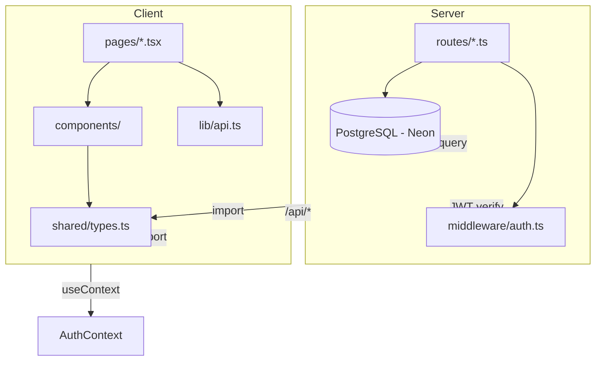
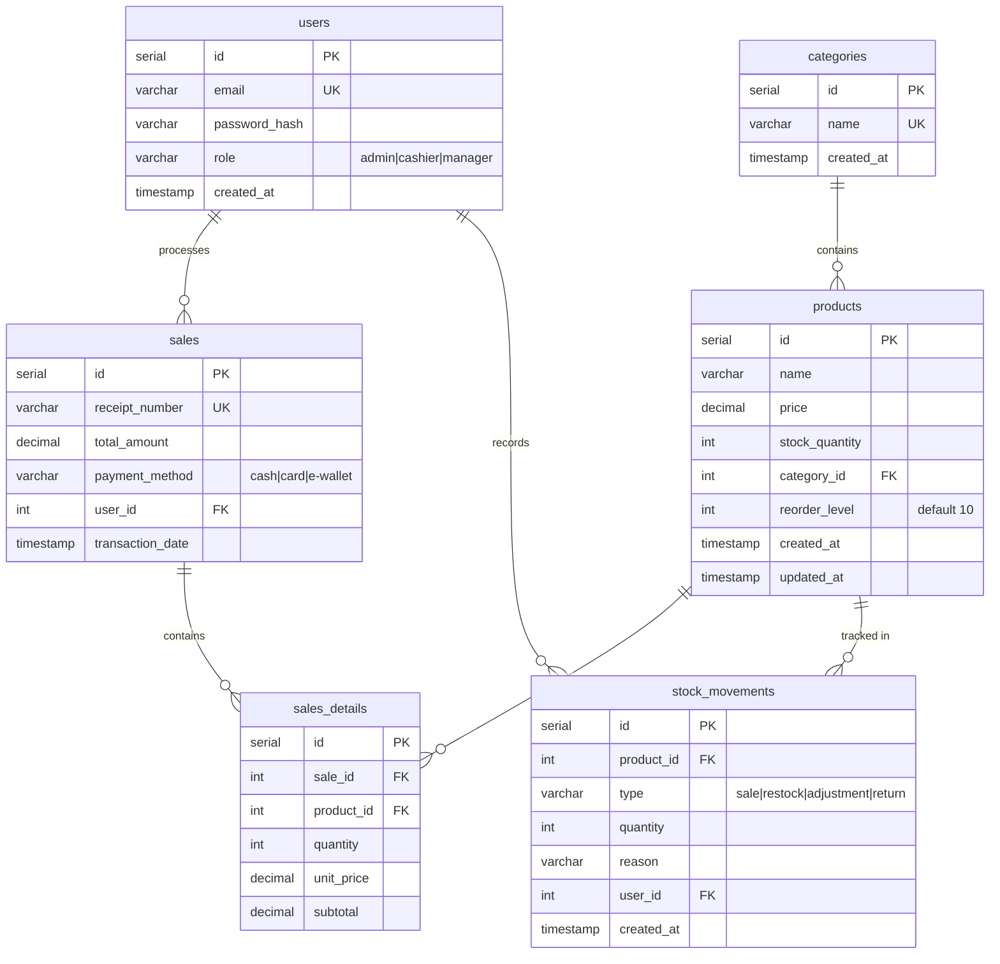

# Architecture Spine — cube-tech-pos

## Design Paradigm

**Layered.** Server: route handlers (controllers) → raw SQL queries via pool → PostgreSQL. Client: pages → extracted components → `lib/api.ts` (fetch wrapper). Auth context sits at the top, consumed by all protected routes.

```
Server:  routes/*.ts  →  db.ts (pool)  →  PostgreSQL
Client:  pages/*.tsx  →  components/  →  lib/api.ts  →  /api/*
```

## Invariants & Rules

### AD-1 — Raw SQL Only, No ORM

- **Binds:** all database access
- **Prevents:** ORM abstraction leakage, hidden queries, migration magic
- **Rule:** All DB access via `pool.query(sql, params)` with `$1, $2, $3` placeholders. No Prisma, TypeORM, Sequelize, or Knex. Query logic visible in route files.

### AD-2 — Parameterized Queries Mandatory

- **Binds:** all database queries
- **Prevents:** SQL injection
- **Rule:** Never interpolate values into SQL strings. Always use `$1, $2` parameterized placeholders with the params array.

### AD-3 — Transaction Pattern for Multi-Step Writes

- **Binds:** sale creation, stock updates, any multi-table write
- **Prevents:** partial writes, orphaned records, inconsistent stock counts
- **Rule:** Use `pool.connect()` → `BEGIN` → `client.query()` → `COMMIT` → `client.release()`. On error: `ROLLBACK` → `client.release()` → throw. One connection per transaction.

### AD-4 — JWT Auth with Role Middleware

- **Binds:** CAP-1 (authentication and RBAC)
- **Prevents:** unauthenticated access to protected routes, role escalation
- **Rule:** Tokens signed with `jsonwebtoken`, hashed with `bcryptjs`. Auth middleware extracts user from token. Role middleware checks `req.user.role` against allowed roles. Routes declare required roles.

### AD-5 — Client Uses Relative API URLs

- **Binds:** all client-side fetch calls
- **Prevents:** hardcoded localhost URLs, CORS issues in production
- **Rule:** Client always calls `/api/...` (relative) in dev, where the Vite proxy forwards to `:5000`. In production the client is a separate Vercel project and reads `VITE_API_URL` at **build** time to reach the server deployment; Vite bakes that value into the bundle, so changing it requires a client redeploy, not just an env edit.

### AD-6 — Shared Types from Single Source

- **Binds:** CAP-8 (shared type safety)
- **Prevents:** client/server type drift
- **Rule:** `shared/types.ts` contains all TypeScript interfaces. Server imports directly. Client imports directly (Vite resolves via path alias). Changing a type in `shared/` causes compile errors in both.

### AD-7 — Component Extraction Pattern

- **Binds:** CAP-7 (reusable components)
- **Prevents:** duplicated UI code, inconsistent styling
- **Rule:** Every repeated UI pattern (modal, table, button, toast, badge) extracted to `client/src/components/`. Pages compose components, never inline modals/tables. Props typed from `shared/types.ts`.

### AD-8 — USD Currency Everywhere

- **Binds:** all price displays, payment handling
- **Prevents:** mixed currency symbols
- **Rule:** Display as `$X.XX`. Store as decimal(10,2). API returns numeric values - the OID-1700 type parser in `server/db.ts` keeps `numeric` as a JS number rather than the pg default string. The client formats with `formatCurrency()` from `client/src/lib/api.ts`, never with a hand-typed symbol and never with a raw `Intl.NumberFormat` call in a page.

### AD-9 — Auth Context for Client State

- **Binds:** CAP-1 (client-side auth state)
- **Prevents:** prop drilling auth through every component
- **Rule:** React Context (`AuthContext`) holds current user + token. Provider wraps `<App>`. Protected routes check context. Login/logout mutate context.

### AD-10 — Deployment Split

- **Binds:** all deployment
- **Prevents:** assumption of monolithic deployment
- **Rule:** Two independent Vercel projects from this one repo - Root Directory `server` (Express via `server/api/index.ts`, which wraps the app for the serverless handler; `server/index.ts` only calls `listen` when run directly) and Root Directory `client` (Vite static build). Database → Neon PostgreSQL free tier. `DATABASE_URL` (or `POSTGRES_URL`) and `JWT_SECRET` are env vars on the server project only. Client needs `VITE_API_URL` at build time.

## Dependency Diagram



## Consistency Conventions

| Concern | Convention |
|---------|------------|
| File naming | `kebab-case` for files, `PascalCase` for components, `camelCase` for functions/variables |
| API responses | `{ data: T }` for success, `{ error: string }` for failure |
| Error handling | Server: try/catch in every route, return `{ error }` with status code. Client: `.catch()` + toast notification |
| IDs | Auto-incrementing integers (`SERIAL` in PostgreSQL) |
| Timestamps | `created_at` / `updated_at` columns, PostgreSQL `DEFAULT NOW()` |
| Dates | ISO 8601 strings in API, formatted for display in client |
| Env vars | Server: `DATABASE_URL` (or `POSTGRES_URL`), `JWT_SECRET`, `PORT`. Client: `VITE_API_URL` (build-time). Missing `JWT_SECRET` fails only on *correct* credentials - bcrypt passes, then `sign` throws - so it presents as a wrong-password bug. |
| Auth token | Stored in `localStorage` via the helpers in `client/src/lib/api.ts`, sent as an `Authorization: Bearer` header. Not a cookie. |
| Currency formatting | Always `formatCurrency()` from `client/src/lib/api.ts`. |
| UI colors | Named palette tokens from `tailwind.config.js` (`brand`, `accent`, `teal`, `ink`). No raw `indigo-*`/`gray-*` classes in new code. |
| Icons | `lucide-react` components only, `currentColor`, 16/20/24px, default 2px stroke. Emoji and Unicode glyphs are banned as icons; the `✕` in `Modal.tsx` is replaced by `<X />`. |
| Emphasis | Size, weight, and color. No glow, neon, bloom, or colored shadow anywhere. |

## Stack

| Name | Version | Role |
|------|---------|------|
| Node.js | 20+ | Runtime |
| TypeScript | 5.5+ | Type system |
| Express | ^4.21 | HTTP framework |
| PostgreSQL | 15+ (Neon) | Database |
| pg (postgres) | ^8.x | PostgreSQL driver |
| bcryptjs | ^2.4 | Password hashing |
| jsonwebtoken | ^9.x | JWT tokens |
| React | ^18.3 | UI library |
| Vite | ^5.4 | Build tool |
| Tailwind CSS | ^3.4 | Styling |
| Recharts | ^2.x | Dashboard / Reports charts - **not yet installed**; CAP-4 must add it to `client/package.json`. No other charting library. |
| lucide-react | ^0.4xx | The only icon library - **not yet installed**; CAP-7 must add it. Icons are React components at 16/20/24px with `currentColor` and lucide's default stroke. No emoji, no Unicode glyphs, no inline SVG, no icon font, no second library. See DESIGN.md `## Icons`. |
| React Router | ^6.26 | Client routing |
| concurrently | ^8.2 | Dev orchestration |

## Structural Seed

```text
cube-tech-pos/
├── shared/
│   └── types.ts              # All TypeScript interfaces (User, Product, Category, Sale, etc.)
├── client/
│   ├── src/
│   │   ├── main.tsx          # Entry, AuthContext provider
│   │   ├── App.tsx           # Routes, protected route wrapper
│   │   ├── index.css         # Tailwind directives
│   │   ├── components/       # Reusable: Modal, Button, Table, Toast, Badge, etc.
│   │   ├── pages/            # Dashboard, Inventory, POS, Transactions, Login, Reports
│   │   ├── contexts/         # AuthContext
│   │   └── lib/
│   │       └── api.ts        # fetchApi<T> helper
│   ├── vite.config.ts        # /api proxy, shared/ alias
│   └── package.json
├── server/
│   ├── index.ts              # Express app, CORS, routes mounted
│   ├── db.ts                 # PostgreSQL pool
│   ├── db.sql                # Schema (PostgreSQL syntax)
│   ├── middleware/
│   │   └── auth.ts           # JWT verify + role check middleware
│   ├── routes/
│   │   ├── auth.ts           # POST /register, POST /login
│   │   ├── products.ts       # CRUD + categories
│   │   ├── sales.ts          # Create sale, list, detail
│   │   ├── dashboard.ts      # Stats + charts data
│   │   ├── categories.ts     # CRUD for categories
│   │   ├── reports.ts        # Date-range filtered analytics
│   │   └── stock.ts          # Stock movements, low-stock alerts
│   └── package.json
└── package.json              # Root orchestration
```

## Database Schema



## Capability → Architecture Map

| Capability | Lives in | Governed by |
|------------|----------|-------------|
| CAP-1: Auth + RBAC | `server/routes/auth.ts`, `server/middleware/auth.ts`, `client/src/contexts/AuthContext.tsx` | AD-4, AD-9 |
| CAP-2: Categories + Search | `server/routes/categories.ts`, `client/src/pages/Inventory.tsx` | AD-1, AD-7 |
| CAP-3: Payment Methods | `server/routes/sales.ts`, `client/src/pages/POS.tsx` | AD-3, AD-8 |
| CAP-4: Sales Analytics | `server/routes/reports.ts`, `client/src/pages/Reports.tsx` | AD-1, AD-7 |
| CAP-5: Stock Alerts | `server/routes/stock.ts`, `client/src/pages/Dashboard.tsx` | AD-1, AD-3 |
| CAP-6: Receipts | `client/src/pages/Transactions.tsx`, print styles | AD-7 |
| CAP-7: Component Library | `client/src/components/` | AD-7 |
| CAP-8: Shared Types | `shared/types.ts` | AD-6 |
| CAP-9: Responsive | Tailwind responsive classes, `CartDrawer` component | AD-7, AD-9 |

## Deferred

- **Testing framework** — spec says testing comes later (Vitest + Playwright)
- **CI/CD** — GitHub Actions, deferred to Phase 4
- **Docker** — deferred to Phase 4
- **Receipt PDF generation** — print-only for now, PDF is a future enhancement

### Resolved since the draft

- **Shared types import path** — no Vite alias needed. Client pages import `shared/types` by relative path (`../../shared/types`), which Vite resolves for both `tsc` and the production build. Verified in shipped code; the alias idea is dropped.
- **Deployment target** — Render was planned; the repo ships two Vercel projects instead (`server/vercel.json`, `client/vercel.json`). AD-5 and AD-10 were corrected to match.
